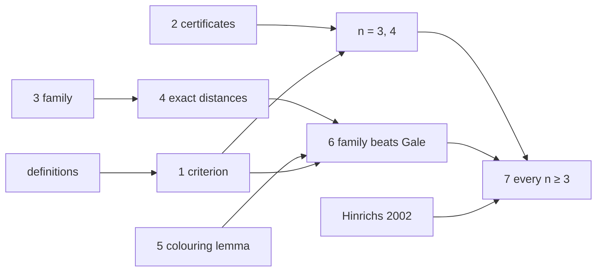
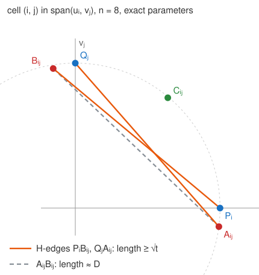

# Gale's conjecture fails in every dimension $n\ge 3$

🎯 Explicit finite sets beat the ball's bound.

```math
\forall n\ge 3:\quad \neg\thinspace \mathrm{Gale}(n)
```

[`gale_fails`](../../Riemann/Deep/LeanGale/Main.lean#L266-L273) · [`gale_fails_le_1000`](../../Riemann/Deep/LeanGale/Main.lean#L227-L236) (no hypothesis, $n\le 1000$) · [discovery page](../../discoveries/gale-r7-r8.md)

## Trust base

🎯 Three axioms, one kernel, two cited facts.

| Layer | Used | Source |
|---|---|---|
| Kernel | Lean 4 v4.35.0-rc2 · Mathlib | [`lean-toolchain`](../../lean-toolchain) |
| Axioms | `propext` · `Classical.choice` · `Quot.sound` | [#print axioms](../../Riemann/Deep/LeanGale/build.log#L37-L43) |
| Finite checks | `decide +kernel`, no `native_decide` | [`P7.run_ok`](../../Riemann/Deep/LeanGale/P7.lean#L24) |
| Cited, $n\gt 1000$ | Hinrichs 2002, Theorem 1: Borsuk fails for $d\gt 322$ | [`Hinrichs2002`](../../Riemann/Deep/LeanGale/Main.lean#L238-L247) |
| Cited, ball form only | $\beta_{n+1}(B^n)\le\sigma_n$ (Voronov 2026) | [`SimplexPartitionBound`](../../Riemann/Deep/LeanGale/Main.lean#L275-L281) |
| Review | 3 fresh agent reviewers: fully proved, faithful | [`STATUS.md`](../../Riemann/Deep/LeanGale/STATUS.md#L9) |

## Definitions

🎯 Fix distance, diameter, parts, and Gale's bound.

| | Definition | Lean |
|---|---|---|
| $ℝ^n$ | $d(x,y)=\sqrt{\textstyle\sum_k (x_k-y_k)^2}$ | [`E`](../../Riemann/Deep/LeanGale/Gale.lean#L22-L23), [`dist_toE`](../../Riemann/Deep/LeanGale/Gale.lean#L48-L52) |
| $\mathrm{diam}\thinspace V$ | $\sup_{x,y\in V}d(x,y)$ | Mathlib `Metric.diam` |
| $\beta_k(V)$ | $\inf_{c:ℝ^n\to\mathrm{Fin}\thinspace k}\enspace \sup_{i}\enspace \mathrm{diam}\thinspace \big(V\cap c^{-1}(i)\big)$; parts = colour classes | [`beta`](../../Riemann/Deep/LeanGale/Gale.lean#L25-L28) |
| $\sigma_n$ | $\sqrt{\tfrac{n+1}{n+2}}$ ($n$ even), $\sqrt{\tfrac12+\tfrac12\sqrt{\tfrac{n-1}{n+3}}}$ ($n$ odd) | [`sigma`](../../Riemann/Deep/Gale7/Lean/Defs.lean#L22-L26) |
| $\mathrm{Gale}(n)$ | $\forall V\subsetℝ^n$ bounded: $\beta_{n+1}(V)\le\sigma_n\mathrm{diam}\thinspace V$ | [`GaleConjecture`](../../Riemann/Deep/LeanGale/Gale.lean#L30-L33) |
| $\mathrm{Gale}_B(n)$ | same, with $\beta_{n+1}\big(\bar B(0,\tfrac12)\big)$ for $\sigma_n$ | [`GaleConjectureBall`](../../Riemann/Deep/LeanGale/Gale.lean#L35-L39) |

## Coverage

🎯 Each dimension gets one witness or citation.

| $n$ | Witness $X$ | $\left\lvert X\right\rvert $ | Long pair forced by | Lean |
|---|---|---|---|---|
| 3 | [our set](../../Riemann/Deep/Gale/points.txt) | 170 | certificate (2) | [`P3.lower`](../../Riemann/Deep/LeanGale/P3.lean#L42-L46) |
| 4 | [our set](../../Riemann/Deep/Gale45/points4.txt) | 126 | certificate (2) | [`P4.lower`](../../Riemann/Deep/LeanGale/P4.lean#L42-L46) |
| 5…1000 | family $V_n$ (3) | $p+q+3pq$, $p=\lfloor n/2\rfloor+1$, $q=\lceil n/2\rceil+1$ | colouring lemma (5) | [`famV_facts`](../../Riemann/Deep/LeanGale/Main.lean#L185-L200) |
| > 1000 | Hinrichs's Borsuk set | — | cited | [`gale_fails`](../../Riemann/Deep/LeanGale/Main.lean#L266-L273) |



## Proof

### 1 · Criterion

🎯 One long monochromatic pair defeats every partition.

```math
\begin{aligned}
\text{(H1)}&\quad \forall x,y\in X:\ \lVert x-y\rVert^2\le D^2\\
\text{(H2)}&\quad \forall c:ℝ^n\to\mathrm{Fin}(n+1)\ \ \exists x,y\in X:\ c(x)=c(y),\ \lVert x-y\rVert^2\ge t\\
\text{(H3)}&\quad \sigma_n^2D^2\lt t\\
\Longrightarrow&\quad \sigma_n\,\mathrm{diam}\,X\lt\beta_{n+1}(X)\ \Longrightarrow\ \neg\,\mathrm{Gale}(n)
\end{aligned}
```

[`sigma_mul_diam_lt_beta`](../../Riemann/Deep/LeanGale/Gale.lean#L137-L155) → [`not_gale_of`](../../Riemann/Deep/LeanGale/Gale.lean#L157-L159)

<details><summary>More detail</summary>

| # | Goal → fact | Lean |
|---|---|---|
| 1.1 | 🎯 Mathlib's distance equals the explicit coordinate formula.<br>$d(\iota x,\iota y)=\sqrt{\sum_k(x_k-y_k)^2}$, $\iota$: coordinates $\toℝ^n$ | [`toE`](../../Riemann/Deep/LeanGale/Gale.lean#L43-L44), [`dist_toE`](../../Riemann/Deep/LeanGale/Gale.lean#L48-L52) |
| 1.2 | 🎯 Finite diameter is the largest pairwise distance.<br>$\mathrm{diam}\thinspace \iota X=\max_{x,y\in X}d(x,y)$ | [`diam_XE`](../../Riemann/Deep/LeanGale/Gale.lean#L60-L71) |
| 1.3 | 🎯 A long monochromatic pair lower-bounds every partition.<br>(H2) $\Rightarrow\sqrt t\le\beta_{n+1}(\iota X)$ | [`sqrt_le_beta`](../../Riemann/Deep/LeanGale/Gale.lean#L94-L108) |
| 1.4 | 🎯 Squared bounds become a strict distance gap.<br>$\mathrm{diam}\thinspace X\le\sqrt{D^2}$, $\sigma_n\sqrt{D^2}\lt \sqrt t$ | [`sigma_mul_diam_lt_beta`](../../Riemann/Deep/LeanGale/Gale.lean#L147-L155) |
| 1.5 | 🎯 Bounded witness with gap contradicts Gale's inequality.<br>$V$ bounded, $\sigma_n\mathrm{diam}\thinspace V\lt \beta_{n+1}(V)\Rightarrow\neg\thinspace \mathrm{Gale}(n)$ | [`not_gale_of`](../../Riemann/Deep/LeanGale/Gale.lean#L157-L159) |

</details>

### 2 · Certificates ($n=3,4,7$)

🎯 Kernel replays a refutation tree over colourings.

```math
\begin{aligned}
G_{\ge t}(X)&=\big(X,\ \lbrace xy:\lVert x-y\rVert^2\ge t\rbrace\big)\\
\mathtt{run}(\text{tokens})=\mathtt{true}\ &\Longrightarrow\ \forall c:X\to\mathrm{Fin}(n+1)\ \ \exists\,xy\in G_{\ge t}(X):\ c(x)=c(y)
\end{aligned}
```

| $n$ | $\left\lvert X\right\rvert $ | $D^2\cdot 10^{16}$ | $t\cdot 10^{16}$ | tokens | kernel run |
|---|---|---|---|---|---|
| 3 | 170 | 10000000211897483 | 7932058815501876 | 2834 | [`P3.run_ok`](../../Riemann/Deep/LeanGale/P3.lean#L24) |
| 4 | 126 | 10000000179265409 | 8399124363373578 | 2936 | [`P4.run_ok`](../../Riemann/Deep/LeanGale/P4.lean#L24) |
| 7 | 84 | 10000000213244525 | 8900856812318928 | 18887 | [`P7.run_ok`](../../Riemann/Deep/LeanGale/P7.lean#L24) |

[`exists_mono`](../../Riemann/Deep/LeanGale/Cert.lean#L284-L306) → [`lower_of_cert`](../../Riemann/Deep/LeanGale/Pts.lean#L191-L201)

<details><summary>More detail</summary>

| # | Goal → fact | Lean |
|---|---|---|
| 2.1 | 🎯 Coordinates are integers; kernel checks all distances.<br>$x=a/10^8$, $a\inℤ^n$; all $\lVert x-y\rVert^2\le D^2$, attained; points distinct | [`PtSet`](../../Riemann/Deep/LeanGale/Pts.lean#L56-L65), [`ok`](../../Riemann/Deep/LeanGale/Pts.lean#L77-L83), [`sqd_toPt`](../../Riemann/Deep/LeanGale/Pts.lean#L40-L45) |
| 2.2 | 🎯 One natural number stores all colour domains.<br>bit $8u+i$ set $\iff$ colour $i$ still allowed at vertex $u$ | [`Inv`](../../Riemann/Deep/LeanGale/Cert.lean#L64-L65), [`assign`](../../Riemann/Deep/LeanGale/Cert.lean#L31-L34) |
| 2.3 | 🎯 Four tokens branch, propagate, break symmetry, close.<br>`br v k`: $c(v)=k$ or $c(v)\ne k$ · `unit v k`: forced · `cut v a b`: w.l.o.g. $c(v)\ne b$ · `wipe u`: empty domain | [`Tok`](../../Riemann/Deep/LeanGale/Cert.lean#L39-L44), [`run`](../../Riemann/Deep/LeanGale/Cert.lean#L46-L59) |
| 2.4 | 🎯 Colour swap keeps proper colourings inside domains.<br>domains symmetric in $a,b$ $\Rightarrow$ swap $a\leftrightarrow b$ | [`good_cut`](../../Riemann/Deep/LeanGale/Cert.lean#L151-L174) |
| 2.5 | 🎯 Accepted run leaves no proper colouring alive.<br>$\mathtt{run}=\mathtt{true}\Rightarrow$ no stacked state holds a proper colouring | [`run_sound`](../../Riemann/Deep/LeanGale/Cert.lean#L176-L227) |
| 2.6 | 🎯 Spread masks only encode genuine long edges.<br>mask bit $8w$ of $v\Rightarrow\lVert x_v-x_w\rVert^2\ge t$ | [`SpreadOK`](../../Riemann/Deep/LeanGale/Cert.lean#L259-L263), [`spreadOK_sound`](../../Riemann/Deep/LeanGale/Cert.lean#L265-L282) |
| 2.7 | 🎯 Full domains plus acceptance force monochromatic edge.<br>start: every colour allowed everywhere | [`initS`](../../Riemann/Deep/LeanGale/Cert.lean#L229-L232), [`no_colouring`](../../Riemann/Deep/LeanGale/Cert.lean#L251-L257), [`exists_mono`](../../Riemann/Deep/LeanGale/Cert.lean#L284-L306) |

</details>

### 3 · The family $V_n$

🎯 Two orthogonal simplices carry five point orbits.

```math
\begin{gathered}
ℝ^n=ℝ^{m_1}\oplus ℝ^{m_2},\qquad m_1=\lfloor n/2\rfloor,\ \ m_2=\lceil n/2\rceil\\
\langle u_i,u_k\rangle=\begin{cases}1&i=k\\-1/m_1&i\ne k\end{cases}\qquad
\langle v_j,v_l\rangle=\begin{cases}1&j=l\\-1/m_2&j\ne l\end{cases}
\end{gathered}
```

| Orbit | Point | Count |
|---|---|---|
| $P_i$ | $(r_A u_i,\enspace 0)$ | $p$ |
| $Q_j$ | $(0,\enspace r_B v_j)$ | $q$ |
| $A_{ij}$ | $(a\thinspace u_i,\enspace -b\thinspace v_j)$ | $pq$ |
| $B_{ij}$ | $(-c\thinspace u_i,\enspace d\thinspace v_j)$ | $pq$ |
| $C_{ij}$ | $(e\thinspace u_i,\enspace f\thinspace v_j)$ | $pq$ |



[`famPt`](../../Riemann/Deep/Gale7/Lean/Fam.lean#L41-L47) · [`IsUnitSimplex`](../../Riemann/Deep/Gale7/Lean/Fam.lean#L31-L34) · [`famV`](../../Riemann/Deep/LeanGale/Main.lean#L178-L183) · figure data: [row n = 8](../../Riemann/Deep/LeanGale/Data/Rows00.lean#L14)

<details><summary>More detail</summary>

| # | Goal → fact | Lean |
|---|---|---|
| 3.1 | 🎯 Regular simplices exist in every dimension recursively.<br>$u^{(m+1)}_{m+1}=(0,\dots,0,-1)$, $u^{(m+1)}_j=\big(\alpha\thinspace u^{(m)}_j,\tfrac1{m+1}\big)$, $\alpha=\tfrac{\sqrt{m(m+2)}}{m+1}$ | [`splx`](../../Riemann/Deep/LeanGale/Splx.lean#L17-L21), [`splx_simplex_succ`](../../Riemann/Deep/LeanGale/Splx.lean#L43-L87), [`splx_simplex`](../../Riemann/Deep/LeanGale/Splx.lean#L89-L92) |
| 3.2 | 🎯 Parameters are rationals with twelve decimal digits.<br>$r_A,\dots,f\in10^{-12}ℕ$: row $n$ of [family_params.txt](../../Riemann/Deep/Gale7/family_params.txt) | [`Params`](../../Riemann/Deep/LeanGale/Row.lean#L19-L32), [`prm`](../../Riemann/Deep/LeanGale/Row.lean#L55-L56), [`table`](../../Riemann/Deep/LeanGale/Family.lean#L99-L101), [`params`](../../Riemann/Deep/LeanGale/Family.lean#L127-L128) |
| 3.3 | 🎯 Distinct labels give distinct points; count follows.<br>$\left\lvert V_n\right\rvert =p+q+3pq$ | [`famRow_injective`](../../Riemann/Deep/LeanGale/Row.lean#L209-L229), [`card_Vx'`](../../Riemann/Deep/LeanGale/Family.lean#L35-L55), [`card_famSet`](../../Riemann/Deep/LeanGale/Family.lean#L146-L153) |
| 3.4 | 🎯 Reindexing places the direct sum inside ℝⁿ.<br>$ℝ^{m_1+m_2}\toℝ^n$, coordinates kept | [`reidx`](../../Riemann/Deep/LeanGale/Main.lean#L162-L163), [`transport`](../../Riemann/Deep/LeanGale/Main.lean#L165-L176) |

</details>

### 4 · Exact distances

🎯 Every squared distance is one exact rational.

```math
\begin{gathered}
\lVert x_v-x_w\rVert^2=\sum_{s=1,2}\Big(\kappa_s(v)^2+\kappa_s(w)^2-2\,\kappa_s(v)\,\kappa_s(w)\,g_s\Big)=\mathrm{cls}\big(\mathrm{orb}\,v,\ \mathrm{orb}\,w,\ [i_v=i_w],\ [j_v=j_w]\big)\\
g_s=\begin{cases}1&\text{index } s \text{ of } v,w \text{ equal}\\-1/m_s&\text{else}\end{cases}
\end{gathered}
```

| | $P$ | $Q$ | $A$ | $B$ | $C$ |
|---|---|---|---|---|---|
| $\kappa_1$ | $r_A$ | $0$ | $a$ | $-c$ | $e$ |
| $\kappa_2$ | $0$ | $r_B$ | $-b$ | $d$ | $f$ |

| Kernel check, per row | Over | Lean |
|---|---|---|
| $\mathrm{cls}\le D^2$ | all 100 descriptors | [`descOK`](../../Riemann/Deep/LeanGale/Row.lean#L91-L95) |
| $\mathrm{cls}\ge t$ | 17 edge classes of $H$ | [`descOK`](../../Riemann/Deep/LeanGale/Row.lean#L91-L95), [`adjD`](../../Riemann/Deep/Gale7/Lean/Desc.lean#L73-L96) |
| $\mathrm{cls}\gt 0$ | distinct vertices | [`descOK`](../../Riemann/Deep/LeanGale/Row.lean#L91-L95), [`neD`](../../Riemann/Deep/Gale7/Lean/Desc.lean#L105-L112) |
| $\sigma_n^2D^2\lt t$ | exact integers | [`sigmaOK`](../../Riemann/Deep/LeanGale/Row.lean#L86-L89) |
| all of it | 996 rows, $n=5\ldots1000$ | [`rowOK`](../../Riemann/Deep/LeanGale/Row.lean#L97-L99), [`table_ok`](../../Riemann/Deep/LeanGale/Family.lean#L103-L123) |

[`sqd_famPt`](../../Riemann/Deep/Gale7/Lean/Fam.lean#L85-L96)

<details><summary>More detail</summary>

| # | Goal → fact | Lean |
|---|---|---|
| 4.1 | 🎯 Direct sums add their squared distances blockwise.<br>$\lVert(x,y)-(x',y')\rVert^2=\lVert x-x'\rVert^2+\lVert y-y'\rVert^2$ | [`sqd_append`](../../Riemann/Deep/Gale7/Lean/Fam.lean#L73-L75) |
| 4.2 | 🎯 Scaled simplex vectors expand by Gram matrix.<br>$\lVert\alpha u-\alpha'u'\rVert^2=\alpha^2\lVert u\rVert^2+\alpha'^2\lVert u'\rVert^2-2\alpha\alpha'\langle u,u'\rangle$ | [`sqd_smul`](../../Riemann/Deep/Gale7/Lean/Fam.lean#L77-L83), [`sqd_famPt`](../../Riemann/Deep/Gale7/Lean/Fam.lean#L85-L96) |
| 4.3 | 🎯 Rational parameters give integer class values exactly.<br>$\mathrm{cls}=\mathrm{clsZ}/(m_1m_2\thinspace 10^{24})$, $\mathrm{clsZ}\inℤ$ | [`clsQ`](../../Riemann/Deep/Gale7/Lean/Desc.lean#L65-L71), [`clsZ`](../../Riemann/Deep/LeanGale/Row.lean#L50-L53), [`clsQ_eq`](../../Riemann/Deep/LeanGale/Row.lean#L66-L73), [`sqd_famRow`](../../Riemann/Deep/LeanGale/Row.lean#L132-L140) |
| 4.4 | 🎯 Edges of H have computable descriptor classes.<br>$\mathrm{Adj}(v,w)\Rightarrow\mathrm{adjD}(\mathrm{desc}(v,w))$ | [`adjD`](../../Riemann/Deep/Gale7/Lean/Desc.lean#L73-L96), [`adj_adjD`](../../Riemann/Deep/Gale7/Lean/Desc.lean#L98-L103) |
| 4.5 | 🎯 Integer inequality certifies the strict sigma gap.<br>$n$ even: $(n+1)D^2\lt (n+2)t$; $n$ odd: $D^2\lt 2t$, $(n-1)D^4\lt (n+3)(2t-D^2)^2$ | [`sigmaOK`](../../Riemann/Deep/LeanGale/Row.lean#L86-L89), [`sigma_sq_mul_lt`](../../Riemann/Deep/LeanGale/Row.lean#L142-L176) |
| 4.6 | 🎯 Kernel evaluates all rows in twenty chunks.<br>20 × `rows_ok := by decide +kernel`, chained | [`Rows00.rows_ok`](../../Riemann/Deep/LeanGale/Data/Rows00.lean#L62), [`table_ok`](../../Riemann/Deep/LeanGale/Family.lean#L103-L123), [`chunkOK_getD`](../../Riemann/Deep/LeanGale/Row.lean#L114-L125), [`params_ok`](../../Riemann/Deep/LeanGale/Family.lean#L130-L132) |
| 4.7 | 🎯 Accepted row yields bounded, long, gapped distances.<br>(H1)–(H3) of 1 | [`rowOK_facts`](../../Riemann/Deep/LeanGale/Family.lean#L57-L92) |

</details>

### 5 · Colouring lemma

🎯 Fewer than $p+q$ colours force monochromatic edges.

```math
\begin{gathered}
V\big(H(p,q)\big)=\lbrace P_i,\,Q_j,\,A_{ij},\,B_{ij},\,C_{ij}:\ i\lt p,\ j\lt q\rbrace\\
c:V\big(H(p,q)\big)\to K\ \text{proper}\ \Longrightarrow\ \left\lvert K\right\rvert \ge p+q
\end{gathered}
```

| edge if | $P_k$ | $Q_l$ | $A_{kl}$ | $B_{kl}$ | $C_{kl}$ |
|---|---|---|---|---|---|
| $P_i$ | $i\ne k$ | — | $i\ne k$ | $i=k$ | $i\ne k$ |
| $Q_j$ | — | $j\ne l$ | $j=l$ | $j\ne l$ | $j\ne l$ |
| $A_{ij}$ | $i\ne k$ | $j=l$ | $i\ne k$ | — | $i\ne k$ |
| $B_{ij}$ | $i=k$ | $j\ne l$ | — | $j\ne l$ | $j\ne l$ |
| $C_{ij}$ | $i\ne k$ | $j\ne l$ | $i\ne k$ | $j\ne l$ | $i\ne k,\enspace j\ne l$ |

[`Vx`](../../Riemann/Deep/Gale7/Lean/Lemma.lean#L19-L26) · [`Adj`](../../Riemann/Deep/Gale7/Lean/Lemma.lean#L32-L60) · [`card_le`](../../Riemann/Deep/Gale7/Lean/Lemma.lean#L435-L460) · [`not_colourable`](../../Riemann/Deep/Gale7/Lean/Lemma.lean#L464-L470)

<details><summary>More detail</summary>

| # | Goal → fact | Lean |
|---|---|---|
| 5.1 | 🎯 One colour never spans two parallel blocks.<br>$X_i=\lbrace P_i,A_{ij}\rbrace_j$, $Y_j=\lbrace Q_j,B_{ij}\rbrace_i$; a colour meets $X_i,X_k\Rightarrow i=k$; $Y$ alike | [`InX`](../../Riemann/Deep/Gale7/Lean/Lemma.lean#L81-L82), [`InY`](../../Riemann/Deep/Gale7/Lean/Lemma.lean#L84-L85), [`inX_unique`](../../Riemann/Deep/Gale7/Lean/Lemma.lean#L187-L194), [`inY_unique`](../../Riemann/Deep/Gale7/Lean/Lemma.lean#L196-L203) |
| 5.2 | 🎯 $C_{ij}$ confines its colour to its lines.<br>$c(C_{ij})$ meets $X_k\Rightarrow k=i$, meets $Y_l\Rightarrow l=j$ | [`inX_of_C`](../../Riemann/Deep/Gale7/Lean/Lemma.lean#L205-L211), [`inY_of_C`](../../Riemann/Deep/Gale7/Lean/Lemma.lean#L213-L219) |
| 5.3 | 🎯 Each colour's C-vertices lie on one line.<br>one row or one column | [`RowT`](../../Riemann/Deep/Gale7/Lean/Lemma.lean#L87-L88), [`C_line`](../../Riemann/Deep/Gale7/Lean/Lemma.lean#L221-L244) |
| 5.4 | 🎯 Four disjoint colour types bound the palette.<br>types X, Y, XY, L (meets row block / column block / both / none): $\left\lvert K_X\right\rvert +\left\lvert K_Y\right\rvert +\left\lvert K_{XY}\right\rvert +\left\lvert K_L\right\rvert \le\left\lvert K\right\rvert $ | [`Kx`](../../Riemann/Deep/Gale7/Lean/Lemma.lean#L93-L94), [`Ky`](../../Riemann/Deep/Gale7/Lean/Lemma.lean#L95-L96), [`Kxy`](../../Riemann/Deep/Gale7/Lean/Lemma.lean#L97-L98), [`Kl`](../../Riemann/Deep/Gale7/Lean/Lemma.lean#L99-L100), [`card_split`](../../Riemann/Deep/Gale7/Lean/Lemma.lean#L116-L141) |
| 5.5 | 🎯 Uncovered rows, columns each demand XY colours.<br>$R_0$ = rows without type-X colour: $p\le\left\lvert K_X\right\rvert +\left\lvert R_0\right\rvert $, $\left\lvert R_0\right\rvert \le\left\lvert K_{XY}\right\rvert $; columns alike | [`R0`](../../Riemann/Deep/Gale7/Lean/Lemma.lean#L101-L102), [`C0`](../../Riemann/Deep/Gale7/Lean/Lemma.lean#L103-L104), [`p_le`](../../Riemann/Deep/Gale7/Lean/Lemma.lean#L248-L263), [`q_le`](../../Riemann/Deep/Gale7/Lean/Lemma.lean#L265-L280), [`R0_le`](../../Riemann/Deep/Gale7/Lean/Lemma.lean#L282-L287), [`C0_le`](../../Riemann/Deep/Gale7/Lean/Lemma.lean#L289-L294) |
| 5.6 | 🎯 Each L colour covers a single line.<br>$R_1,C_1$ = lines of L colours: $\left\lvert R_1\right\rvert +\left\lvert C_1\right\rvert \le\left\lvert K_L\right\rvert $ | [`rowsL`](../../Riemann/Deep/Gale7/Lean/Lemma.lean#L105-L107), [`colsL`](../../Riemann/Deep/Gale7/Lean/Lemma.lean#L108-L110), [`R1`](../../Riemann/Deep/Gale7/Lean/Lemma.lean#L111-L112), [`C1`](../../Riemann/Deep/Gale7/Lean/Lemma.lean#L113-L114), [`cover`](../../Riemann/Deep/Gale7/Lean/Lemma.lean#L157-L170), [`R1C1_le`](../../Riemann/Deep/Gale7/Lean/Lemma.lean#L314-L338) |
| 5.7 | 🎯 Free cells exhaust XY colours; contradiction follows.<br>$a=\left\lvert R_0\setminus R_1\right\rvert $, $b=\left\lvert C_0\setminus C_1\right\rvert $; see 5.7a–c | [`card_le`](../../Riemann/Deep/Gale7/Lean/Lemma.lean#L435-L460) |

<details><summary>More detail · step 5.7</summary>

| # | Goal → fact | Lean |
|---|---|---|
| 5.7a | 🎯 Free cells force distinct XY colours injectively.<br>$(i,j)\in(R_0\setminus R_1)\times(C_0\setminus C_1)\Rightarrow c(C_{ij})\in K_{XY}$, injective: $ab\le\left\lvert K_{XY}\right\rvert $ | [`cell`](../../Riemann/Deep/Gale7/Lean/Lemma.lean#L296-L312), [`mem_S_Kxy`](../../Riemann/Deep/Gale7/Lean/Lemma.lean#L340-L347), [`S_le`](../../Riemann/Deep/Gale7/Lean/Lemma.lean#L349-L365) |
| 5.7b | 🎯 Counting forces one free row or column.<br>$\left\lvert K\right\rvert \lt p+q\Rightarrow\left\lvert K_{XY}\right\rvert +1\le a+b$, $a,b\ge1$; $a,b\ge2\Rightarrow ab+1\le a+b$, impossible | [`card_le`](../../Riemann/Deep/Gale7/Lean/Lemma.lean#L437-L457), [`nat_aux`](../../Riemann/Deep/Gale7/Lean/Lemma.lean#L174-L180) |
| 5.7c | 🎯 A single free line forces monochromatic edge.<br>$a=1$: $c(P_{i^\star})=c(B_{i^\star j_0})$; $b=1$: $c(Q_{j^\star})=c(A_{i_0 j^\star})$ | [`case_a`](../../Riemann/Deep/Gale7/Lean/Lemma.lean#L367-L399), [`case_b`](../../Riemann/Deep/Gale7/Lean/Lemma.lean#L401-L433) |

</details>

</details>

### 6 · The family beats Gale

🎯 Each H-edge maps to a long pair.

```math
\begin{aligned}
n+1\lt p+q\ &\overset{5}{\Longrightarrow}\ \forall c\ \exists\,vw\in E(H):\ c(x_v)=c(x_w),\ \lVert x_v-x_w\rVert^2\overset{4}{\ge}t\\
&\overset{1}{\Longrightarrow}\ \sigma_n\,\mathrm{diam}\,V_n\lt\beta_{n+1}(V_n)
\end{aligned}
```

[`long_pair`](../../Riemann/Deep/Gale7/Lean/Crit.lean#L12-L20) → [`rowOK_facts`](../../Riemann/Deep/LeanGale/Family.lean#L57-L92) → [`famV_facts`](../../Riemann/Deep/LeanGale/Main.lean#L185-L200) → [`claim2`](../../Riemann/Deep/LeanGale/Main.lean#L202-L215)

<details><summary>More detail</summary>

| # | Goal → fact | Lean |
|---|---|---|
| 6.1 | 🎯 The colouring lemma applies with $n+1$ colours.<br>$n+2\le p+q$ | [`long_pair`](../../Riemann/Deep/Gale7/Lean/Crit.lean#L12-L20) |
| 6.2 | 🎯 Row check supplies bounds, edge lengths, gap.<br>(H1)–(H3) of 1 for $V_n$ | [`rowOK_facts`](../../Riemann/Deep/LeanGale/Family.lean#L57-L92), [`params_ok`](../../Riemann/Deep/LeanGale/Family.lean#L130-L132) |
| 6.3 | 🎯 Transport to ℝⁿ, then apply the criterion.<br>$\sigma_n\mathrm{diam}\thinspace V_n\lt \beta_{n+1}(V_n)$ | [`transport`](../../Riemann/Deep/LeanGale/Main.lean#L165-L176), [`famV_facts`](../../Riemann/Deep/LeanGale/Main.lean#L185-L200) |
| 6.4 | 🎯 Ratio form and partition form follow directly.<br>$\sigma_n\lt \beta_{n+1}/\mathrm{diam}\thinspace $; $\forall c\thinspace \exists k:\enspace \sigma_n\mathrm{diam}\thinspace V_n\lt \mathrm{diam}\thinspace (V_n\cap c^{-1}k)$ | [`sigma_lt_ratio`](../../Riemann/Deep/LeanGale/Main.lean#L43-L53), [`exists_part_gt`](../../Riemann/Deep/LeanGale/Gale.lean#L161-L165), [`claim2`](../../Riemann/Deep/LeanGale/Main.lean#L202-L215) |

</details>

### 7 · Every $n\ge 3$

🎯 Cover each dimension; borrow Borsuk beyond thousand.

| $n$ | Proof | Lean |
|---|---|---|
| 3, 4 | 1 + 2 | [`hσ3`](../../Riemann/Deep/LeanGale/Main.lean#L219-L221), [`hσ4`](../../Riemann/Deep/LeanGale/Main.lean#L223-L225), [`gale_fails_le_1000`](../../Riemann/Deep/LeanGale/Main.lean#L227-L236) |
| 5…1000 | 6, simplices from 3.1 | [`gale_fails_le_1000`](../../Riemann/Deep/LeanGale/Main.lean#L227-L236) |
| > 1000 | Hinrichs set $S$ + $\sigma_n\lt 1$ | [`not_gale_of_borsuk`](../../Riemann/Deep/LeanGale/Main.lean#L249-L264), [`gale_fails`](../../Riemann/Deep/LeanGale/Main.lean#L266-L273) |

<details><summary>More detail</summary>

| # | Goal → fact | Lean |
|---|---|---|
| 7.1 | 🎯 Hinrichs's sets always keep a full-diameter part.<br>$\forall d\gt 322\enspace \exists S$ bounded, $\ge 2$ points: $\forall c\thinspace \exists k:\enspace \mathrm{diam}\thinspace (S\cap c^{-1}k)\nless \mathrm{diam}\thinspace S$ | [`Hinrichs2002`](../../Riemann/Deep/LeanGale/Main.lean#L238-L247) |
| 7.2 | 🎯 Sigma stays below one in every dimension.<br>$\sigma_n\lt 1$ | [`sigma_lt_one`](../../Riemann/Deep/LeanGale/Gale.lean#L123-L133) |
| 7.3 | 🎯 Borsuk counterexamples are also Gale counterexamples, automatically.<br>$\mathrm{Gale}(d)\Rightarrow\beta_{d+1}(S)\le\sigma_d\mathrm{diam}\thinspace S\lt \mathrm{diam}\thinspace S\Rightarrow$ some $c$ has all parts $\lt \mathrm{diam}\thinspace S$, contradiction | [`not_gale_of_borsuk`](../../Riemann/Deep/LeanGale/Main.lean#L249-L264) |
| 7.4 | 🎯 Split the cases at three, four, thousand.<br>$n=3$, $n=4$, $5\le n\le1000$, $n\gt 1000$ | [`gale_fails_le_1000`](../../Riemann/Deep/LeanGale/Main.lean#L227-L236), [`gale_fails`](../../Riemann/Deep/LeanGale/Main.lean#L266-L273) |

</details>

## Also proved

🎯 Exact cut ratios in dimensions seven, eight.

| Claim | Statement | Lean |
|---|---|---|
| $ℝ^7$ | 84 points; $\beta_8/D=\sqrt{8900856812318928/10000000213244525}=0.9434435130\ldots\gt \sigma_7=0.9419651451\ldots$ | [`claim1_n7`](../../Riemann/Deep/LeanGale/Main.lean#L93-L124) |
| $ℝ^8$ | 85 points; $\beta_9/D=\sqrt{9023994457279939/10000000157507010}=0.9499470677\ldots\gt \sigma_8=0.9486832981\ldots$ | [`claim1_n8`](../../Riemann/Deep/LeanGale/Main.lean#L137-L156) |
| family | $\forall n\in[5,1000]$, all unit simplices: $\left\lvert V_n\right\rvert =p+q+3pq$, $\beta_{n+1}/D\gt \sigma_n$ | [`claim2`](../../Riemann/Deep/LeanGale/Main.lean#L202-L215) |
| ball | $`\forall n\ge3:\ \neg\,\mathrm{Gale}_B(n)`$, given $`\beta_{n+1}(B^n)\le\sigma_n`$ | [`gale_ball_fails`](../../Riemann/Deep/LeanGale/Main.lean#L283-L289) |

<details><summary>More detail</summary>

| # | Goal → fact | Lean |
|---|---|---|
| A.1 | 🎯 Matching lower and upper bounds fix beta.<br>$\sqrt t\le\beta\le\sqrt t$ | [`beta_eq`](../../Riemann/Deep/LeanGale/Main.lean#L30-L34), [`beta_le_sqrt`](../../Riemann/Deep/LeanGale/Gale.lean#L110-L121) |
| A.2 | 🎯 An explicit colouring gives the upper bound.<br>stored colouring: same colour $\Rightarrow\lVert x-y\rVert^2\le t$ | [`PtSet.upper`](../../Riemann/Deep/LeanGale/Pts.lean#L162-L189), [`P7.upper`](../../Riemann/Deep/LeanGale/P7.lean#L48-L52), [`P8.upper`](../../Riemann/Deep/LeanGale/P8.lean#L59-L63) |
| A.3 | 🎯 Labels send H's edges to long pairs.<br>`idx`: $V(H(5,5))\to$ points, every edge $\mapsto$ pair at $\ge t$ | [`P8.idx`](../../Riemann/Deep/LeanGale/P8.lean#L23-L29), [`P8.H_ok`](../../Riemann/Deep/LeanGale/P8.lean#L33-L35), [`lower_of_labels`](../../Riemann/Deep/LeanGale/Pts.lean#L219-L241) |
| A.4 | 🎯 The decimal values hold to ten places.<br>$\left\lvert x-d\right\rvert \lt 5\cdot10^{-11}$; $\sigma_7=\sqrt{\tfrac12+\tfrac12\sqrt{3/5}}$, $\sigma_8=\sqrt{9/10}$ | [`sqrt_near`](../../Riemann/Deep/LeanGale/Main.lean#L70-L78), [`claim1_n7`](../../Riemann/Deep/LeanGale/Main.lean#L110-L124) |
| A.5 | 🎯 Cited ball bound turns σ-form into ball-form.<br>$\beta_{n+1}(B^n)\le\sigma_n\Rightarrow(\mathrm{Gale}_B\Rightarrow\mathrm{Gale})$ | [`SimplexPartitionBound`](../../Riemann/Deep/LeanGale/Main.lean#L275-L281), [`gale_ball_fails`](../../Riemann/Deep/LeanGale/Main.lean#L283-L289) |

</details>
